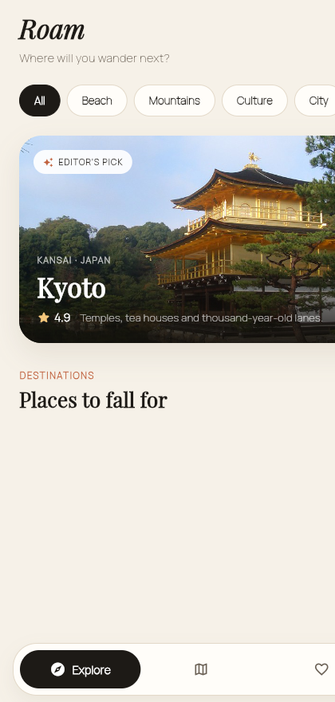

# Roam — Travel Planner

A modern travel planner for discovering destinations and building trips.
Built with **Flutter** and **Cubit (`flutter_bloc`)**.

<p align="center">
  
</p>

## Highlights

- **Explore destinations** through editorial image cards with a featured
  “Editor’s Pick” hero.
- **Destination details** with a parallax, collapsing image header, rating,
  best-season info and curated highlights.
- **Save favourites** with an animated heart and a dedicated *Saved* tab.
- **Plan trips** — create, edit and delete trips with cover art and dates.
- **Build a day-by-day itinerary** with a **reorderable** activity list and
  full add / edit / delete support.
- Thoughtful **empty states** and input validation throughout.

## Motion & interaction

- `Hero` transitions from every destination card into the detail header.
- Custom `RoamPageRoute` fade-and-lift page transitions.
- Staggered reveal animation for grid and list items.
- `AnimatedSwitcher`, `AnimatedScale` and implicit animations on chips,
  hearts and the bottom navigation.
- Press feedback on cards and fluid `ReorderableListView` drag handles.

## Architecture

Presentation, state management and data logic are kept separate.

```
lib/
├── main.dart                     # entry point, wires SharedPreferences + repository
├── app.dart                      # MultiBlocProvider + MaterialApp
├── app_shell.dart                # bottom navigation shell
├── core/                         # theme, typography, sample data, helpers
│   ├── theme/
│   ├── sample_data.dart
│   ├── page_route.dart
│   └── format.dart
├── data/                         # models + repositories
│   ├── models/                   # Destination, Trip, Activity
│   └── repositories/             # RoamRepository + LocalRoamRepository
├── features/                     # one folder per feature: cubit + view + widgets
│   ├── explore/
│   ├── destination/
│   ├── favorites/
│   └── trips/
└── widgets/                      # reusable widgets (Photo, EmptyState, ...)
```

### State (Cubit)

| Cubit | Responsibility |
| --- | --- |
| `ExploreCubit` | destination list, category filter and search |
| `FavoritesCubit` | saved destination ids (persisted) |
| `TripsCubit` | trip + itinerary CRUD and reordering (persisted) |

### Persistence

Favourites and trips/itineraries are stored locally as JSON in
`shared_preferences`, so your changes survive restarts. Data access goes
through the `RoamRepository` abstraction.

## Getting started

```bash
# from the roam/ directory
flutter pub get

# run on the web (fastest to preview)
flutter run -d chrome

# run on a connected phone (Android/iOS)
flutter run
```

Build a release web bundle:

```bash
flutter build web --release
```

## Notes

- All destination content is realistic **sample data** (`core/sample_data.dart`).
- Photography and fonts are open-licenced — see
  [`docs/ATTRIBUTIONS.md`](docs/ATTRIBUTIONS.md).

## Tech

Flutter · Dart · `flutter_bloc` (Cubit) · `equatable` · `shared_preferences`.
